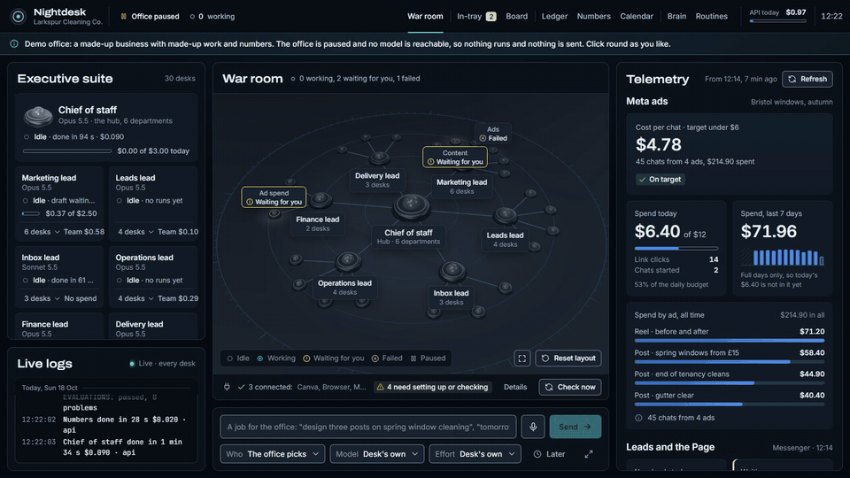
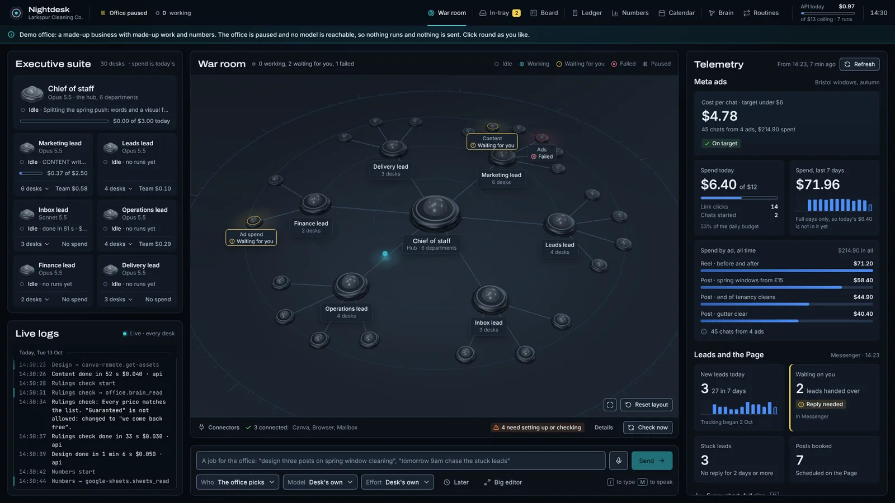
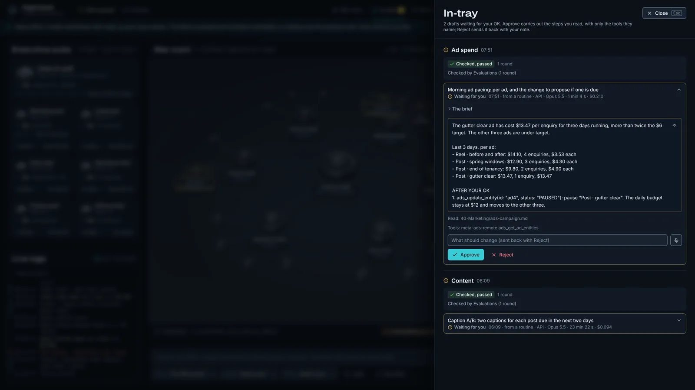
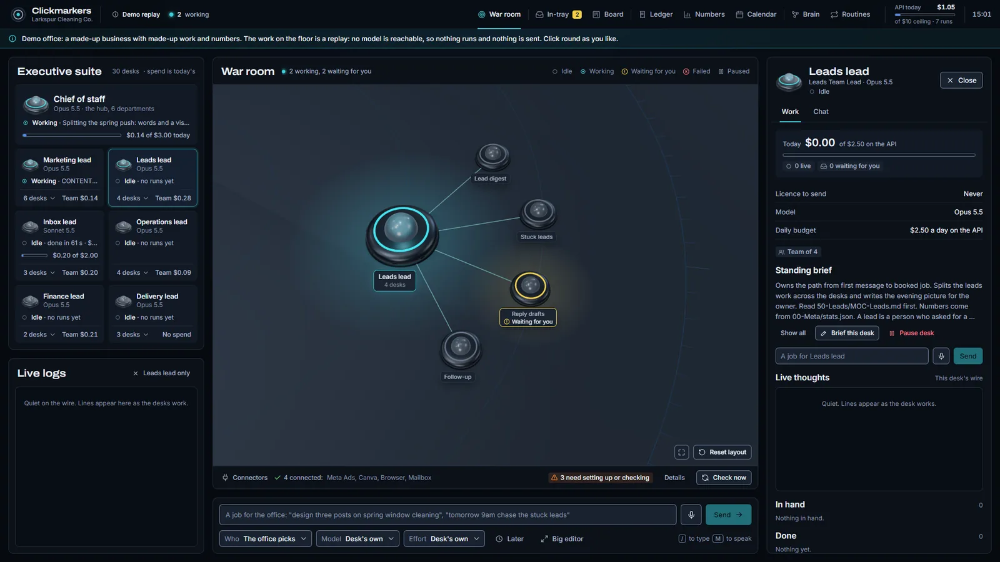
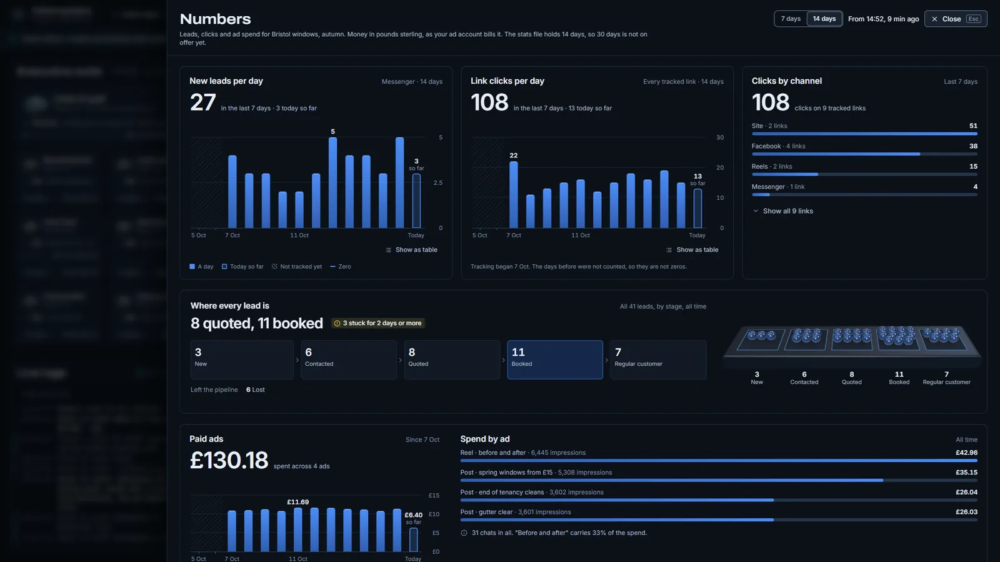
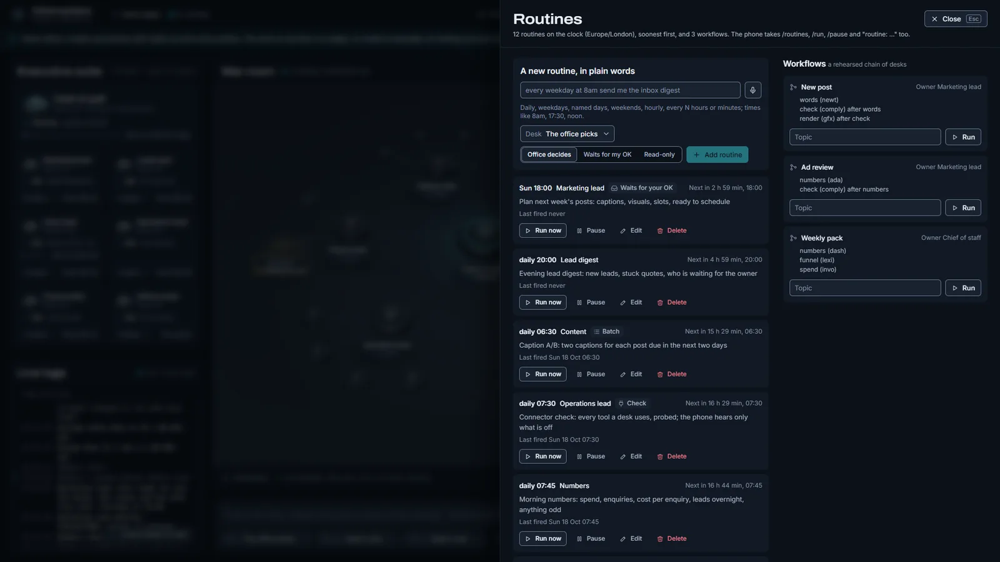
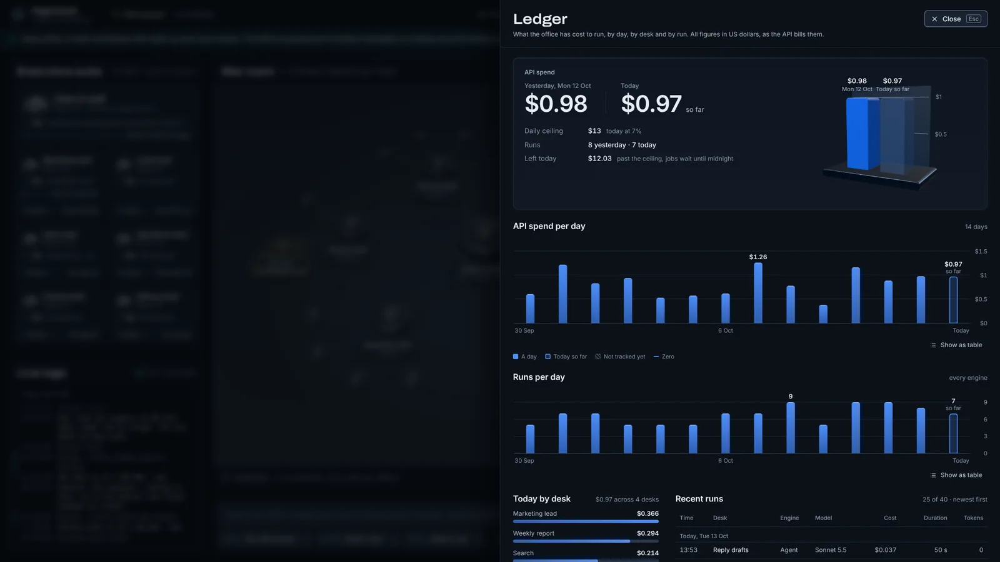

<h1 align="center">Nightdesk</h1>

<p align="center"><b>Your own AI marketing agency, on your own computer.<br>It works the night shift, and nothing goes out without your OK.</b></p>

<p align="center">Nightdesk by Alex Cojoaca</p>

<p align="center">
  <a href="LICENSE"></a>
  
  <a href="https://github.com/AlexCJK1/nightdesk/actions/workflows/test.yml"></a>
  <a href="SECURITY.md"></a>
  
</p>

<p align="center"></p>

Nightdesk runs a small company of AI desks for your business: a chief of staff, six department leads
and the specialists under them, for posts, design, ads, the inbox, leads, the numbers and the weekly
report. You give it jobs in plain words, on the page or from your phone. The desks do the work with
your real tools (your ad account, your mailbox, Canva, Google Drive, a browser) and anything that would
send, post, book or spend comes to your **in-tray** as a draft. One tap approves it.

It is for the businesses that cannot afford an agency and have no time to run one: a window cleaner,
a café, a lettings agent, a recruiter, a one-person shop.

**Status:** early (0.1). It grew out of the AI office the author uses every day for his own business's
marketing. Expect rough edges, and please report them.

## Try it in two minutes

You need [Node 22 or newer](https://nodejs.org). The demo needs no API key and sends nothing.

```bash
git clone https://github.com/AlexCJK1/nightdesk.git
cd nightdesk
npm install
npm run build
npm run demo:show
```

Open <http://127.0.0.1:4600>. You get Larkspur Cleaning Co., a made-up window cleaner in Bristol: 30
desks, two drafts waiting for your OK, a fortnight of numbers, and a scripted day replayed on the floor.
Press `?` for the keys, `I` for the in-tray, `N` for the numbers.

## What it does

<table>
<tr><td width="50%"></td><td>

**A war room you can watch.** Every desk is a pod on a live floor. Work moving between desks lights the
lines, and each desk shows what it is doing in words, not only colours. The executive suite, the live
logs and your numbers sit around it.

</td></tr>
<tr><td></td><td>

**An in-tray, not an autopilot.** Drafts arrive already checked: a separate evaluations desk reads each
one against your facts, your house rules and your past corrections before you see it. **Approve** carries
out the steps you read, with only the tools they name. **Reject** with a note sends it back, and the desk
keeps the lesson.

</td></tr>
<tr><td></td><td>

**Desks you manage like staff.** Give each one a standing brief, a model, a daily budget and the tools
it may use. Pause it, chat with it, see what it has in hand and what it finished. Leads split big jobs
and hand pieces to their team.

</td></tr>
<tr><td></td><td>

**Your numbers in one place.** Ad spend, cost per enquiry, leads, the pipeline, clicks by channel, all
from one stats file you control. Desks quote those figures instead of guessing, and every chart can show
itself as a table.

</td></tr>
<tr><td></td><td>

**Routines in plain English.** "Every weekday at 8am send me the inbox digest." The calendar shows what
runs when, and workflows chain desks together: `new-post: spring windows` has one desk write, one check
the rules, one design, and the lead put it together for your OK.

</td></tr>
<tr><td></td><td>

**Costs you can see.** Every run is a line in the ledger, by desk and by model. A daily ceiling stops new
runs when it is reached; jobs wait until midnight. Prompt caching and the Batch API keep runs cheap.

</td></tr>
</table>

Also: **your phone** (a Telegram bot: jobs, voice notes, drafts with Approve buttons, results with
pictures), **a brain** (a folder of your own markdown notes the desks read, drawn as a map that lights up
when a desk reads a note), and **a page that works at phone width**.

## Safe by design

An AI with your mailbox and your ad account must not be able to act on its own. Nightdesk makes sure of
that in code, not by asking the model nicely:

- **Nothing goes out without your OK.** Before you approve, every tool that sends, posts, books, spends
  or changes something is refused, call by call. A tool nobody has listed counts as one that writes.
- **After you approve, only what you approved.** The run gets the exact draft you saw. It may call only
  the tools its steps name, and only with the email addresses and links in that draft.
- **Your data stays home.** It runs on your machine and listens only there. What a desk works on goes
  to the Anthropic API and to the tools you connect, and nowhere else. Your keys never reach the
  connectors it starts. A desk that browses the web is not handed your private notes.
- **Checked by an attacker's eye.** An adversarial review in five rounds tried to break each control.
  What it found is fixed and covered by tests in [`test/security.test.mjs`](test/security.test.mjs).

What it cannot promise, and how to report a problem: [SECURITY.md](SECURITY.md).

## What it costs

Nightdesk is free. The AI is billed to your own [Anthropic API key](https://console.anthropic.com), pay
as you go, and you set the daily ceiling (the default is $13, about £10). One measured example: a
four-desk chain that wrote, checked and designed a social post took two minutes and cost $1.00.

Connectors use your own accounts: Google Drive, Docs, Sheets and Calendar, any IMAP mailbox, Meta Ads,
Canva, Figma, a browser, and any MCP server you add.

## Set it up for your business

You need Node 22+, an Anthropic API key, and a computer that stays on while the office works (Windows,
macOS or Linux).

1. **Install.** `npm install`, then `npm run build`.
2. **Configure.** Copy `office.config.local.example.json` to `office.config.local.json`. Point `brain`
   at a folder for your notes (start from `examples/brain`). `secretsFile` names the secrets file: the
   example's `.secrets.local` is ignored by git, or point it anywhere outside the folder.
3. **Add your key.** Put `ANTHROPIC_API_KEY=...` in that secrets file. Secrets never go in the repo.
4. **Describe your business.** Edit `10-Business/business.md` and the facts, prices and voice notes in
   your brain folder. Desks read them on every job.
5. **Shape the company.** `company/company.json` holds the desks: names, roles, briefs, models, budgets,
   tools. The example is a cleaning company; change it to yours. `templates/it-office` is a second one.
   If you use Claude Code, the repo's `office-ops` skill knows how to add desks, routines and connectors.
6. **Connect your tools.** `node bin/nightdesk.mjs connect google` (Drive, Docs, Sheets, Calendar),
   `connect meta` (Meta Ads), `connect mcp canva-remote` (any remote MCP server that signs in through a
   browser, done once in Claude Code), or an IMAP mailbox with an app password. `npm run check` says what
   is set up and what is missing.
7. **Optional: your phone.** Make a Telegram bot with @BotFather and put `OFFICE_TELEGRAM_TOKEN` and
   `OFFICE_TELEGRAM_CHAT` in the secrets file.
8. **Start.** `npm start`, then open <http://127.0.0.1:4600>. On Windows,
   `scripts\install-autostart.ps1` starts it at logon and restarts it if it stops.

The full walkthrough of the page, with pictures: **[the guide as a PDF](docs/Nightdesk-guide.pdf)**, or
open `docs/guide/index.html` in your browser for the clickable version.

## How it works

```
 you ──page / phone / CLI──▶ tickets ──▶ heartbeat ──▶ a desk (a Claude session with its brief,
                               ▲                        your notes, its tools and a budget)
           routines (clock) ───┘                                    │
                                                  draft ──▶ evaluations ──▶ your in-tray
                                                                    │
                                                         Approve ──▶ the approved steps, nothing else
```

Each desk is a session on the [Claude Agent SDK](https://code.claude.com/docs/en/agent-sdk/overview)
with its tools served over [MCP](https://modelcontextprotocol.io). Four engines decide where a run goes:
the agent engine for anything with tools, direct API calls for small jobs, the Batch API at half price for
anything that can wait, and OpenRouter for other vendors' models. More in
[ARCHITECTURE.md](ARCHITECTURE.md).

## Roadmap

- A first-run interview that writes your company and your brain for you.
- More company templates: a café, a trades business, a lettings agent, a recruiter.
- More connectors with read-only lists: Shopify, Instagram, Google Business Profile, Xero.
- A weekly batch review of every desk's drafts against your rules.
- Installers for macOS and Linux to match the Windows one.
- The page in more languages.

Ideas and votes are welcome in [Issues](https://github.com/AlexCJK1/nightdesk/issues).

## Contributing

Bug reports, ideas, docs and code are all welcome: see [CONTRIBUTING.md](CONTRIBUTING.md). Issues
labelled `good first issue` are a good start. Contributors sign a short [CLA](CLA.md) once.

If Nightdesk is useful to you, a star helps other small businesses find it.

## Licence

Nightdesk is free software under the [GNU AGPL 3.0](LICENSE), with two additional terms in
[NOTICE](NOTICE): keep the line "Nightdesk by Alex Cojoaca" in the About section and the README of any
copy, and give a changed version that you share or host a name of its own ([TRADEMARKS.md](TRADEMARKS.md)).
You may use it in your business for free. If you change it and offer it to others, including as a hosted
service, the AGPL asks you to publish your changes.

A **commercial licence** is available if the AGPL does not suit you: open an issue titled "Commercial
licence".

Nightdesk is an independent project. It is not made or endorsed by Anthropic. "Claude" is a trademark of
Anthropic.
